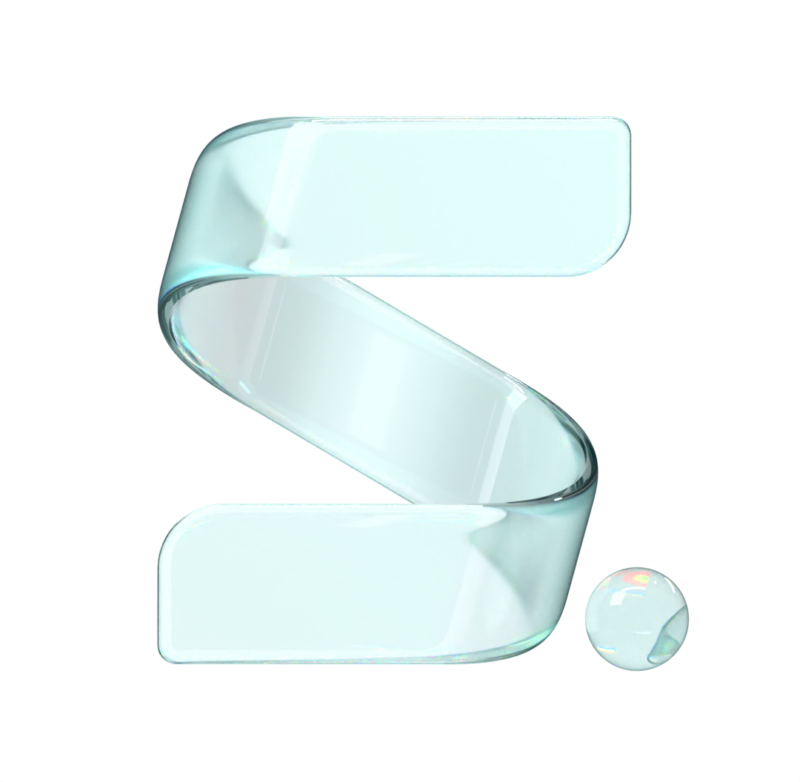

<p align="center">
  
</p>

<h1 align="center">skil.li</h1>

<p align="center">
  <b>Your Mac does what you mean, one key away.</b><br>
  A native macOS launcher that acts: type or say what you want,<br>
  and it finds it or does it, in the app you are in.
</p>

<p align="center">
  <a href="https://skil.li/download"><b>Download</b></a> ·
  <a href="https://skil.li">Website</a> ·
  <a href="docs/MANIFESTO.md">Manifesto</a> ·
  <a href="docs/FEATURES.md">Features</a> ·
  <a href="CONTRIBUTING.md">Contributing</a>
</p>

<p align="center">
  <a href="https://github.com/nomdelasociete/skilli/releases/latest"></a>
  
  <a href="LICENSE"></a>
</p>

## Install

Download [skil.li for macOS 26 or later](https://skil.li/download), or use
Homebrew:

```sh
brew install --cask nomdelasociete/tap/skilli
```

Signed and notarised; it keeps itself up to date. On first launch, allow
Accessibility and connect your SI.

## What it does

- **Launcher.** Apps, files, commands, clipboard history, snippets, emoji,
  windows, calendar and reminders, in one field. It learns what you pick.
- **Ask.** Say what you want, in your words. skil.li answers, rewrites your
  selection, or does it.
- **Your text, anywhere.** Fix, translate or rewrite the selection in any
  app; follow up until it reads right, then ↩ puts it in place.
- **The Hyper Key.** Caps Lock, held, becomes ✦: one key of your own for
  every shortcut and key sequence (✦ K, then G).
- **Your Mac, by keyboard.** Window layouts, timers, Keep Awake, quitting
  apps, sound devices, any app's menus.
- **Built to be built on.** A script becomes a command, MCP servers plug in,
  and your agents can use skil.li too.

Everything, area by area, with its default keys: [FEATURES.md](docs/FEATURES.md).

## Your SI, your data

Bring your own: Claude (a Claude Code subscription or an API key), ChatGPT
(Codex or an API key), and a fast decision model (TypeSafe Jev or OpenAI
Decisions). No credits, no account with us.

Only what a request needs leaves your Mac, and only for the provider you
chose. Settings → Privacy lists every case, with its switch. No telemetry.

## Build from source

macOS 26, Xcode 26 and [XcodeGen](https://github.com/yonaskolb/XcodeGen).

```sh
git clone https://github.com/nomdelasociete/skilli.git
cd skilli
SKILLI_TEAM=<your Apple team ID> ./script/build_and_run.sh run
```

Unit tests: `./script/build_and_run.sh test`. How it is built, and the rules
every change follows: [AGENTS.md](AGENTS.md).

## Contributing

Ideas, bug reports and pull requests are welcome. Start with an issue, so we
agree on the change before you spend time on it: [CONTRIBUTING.md](CONTRIBUTING.md).

## License

skil.li is free software under the [GNU General Public License v3.0](LICENSE).
The website's fonts are under the SIL Open Font License (`website/assets/fonts/`).
The meeting recorder tells voices apart with Argmax's SpeakerKit (MIT) and
pyannote community-1's models converted by Argmax (CC BY 4.0), fetched when
the app is built and shipped in it.

Made by [Nom de la société](https://nomdelasociete.com).
