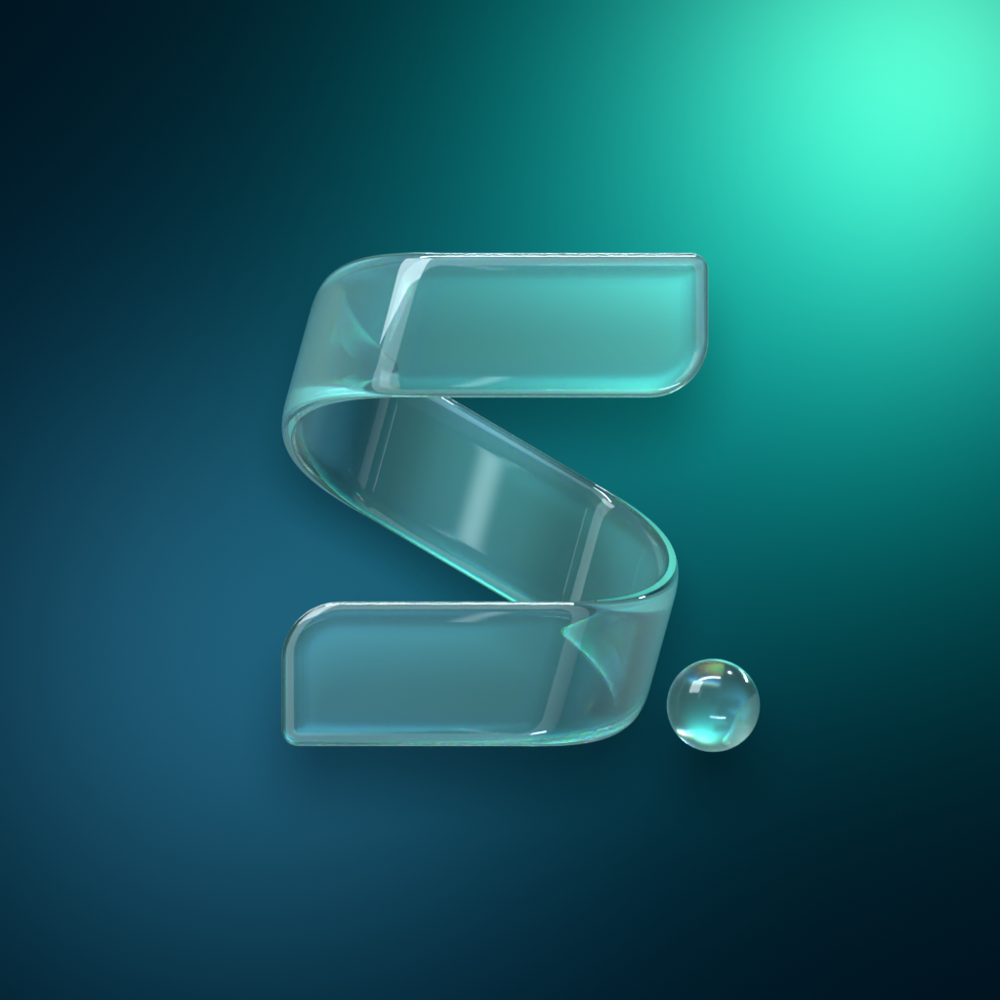
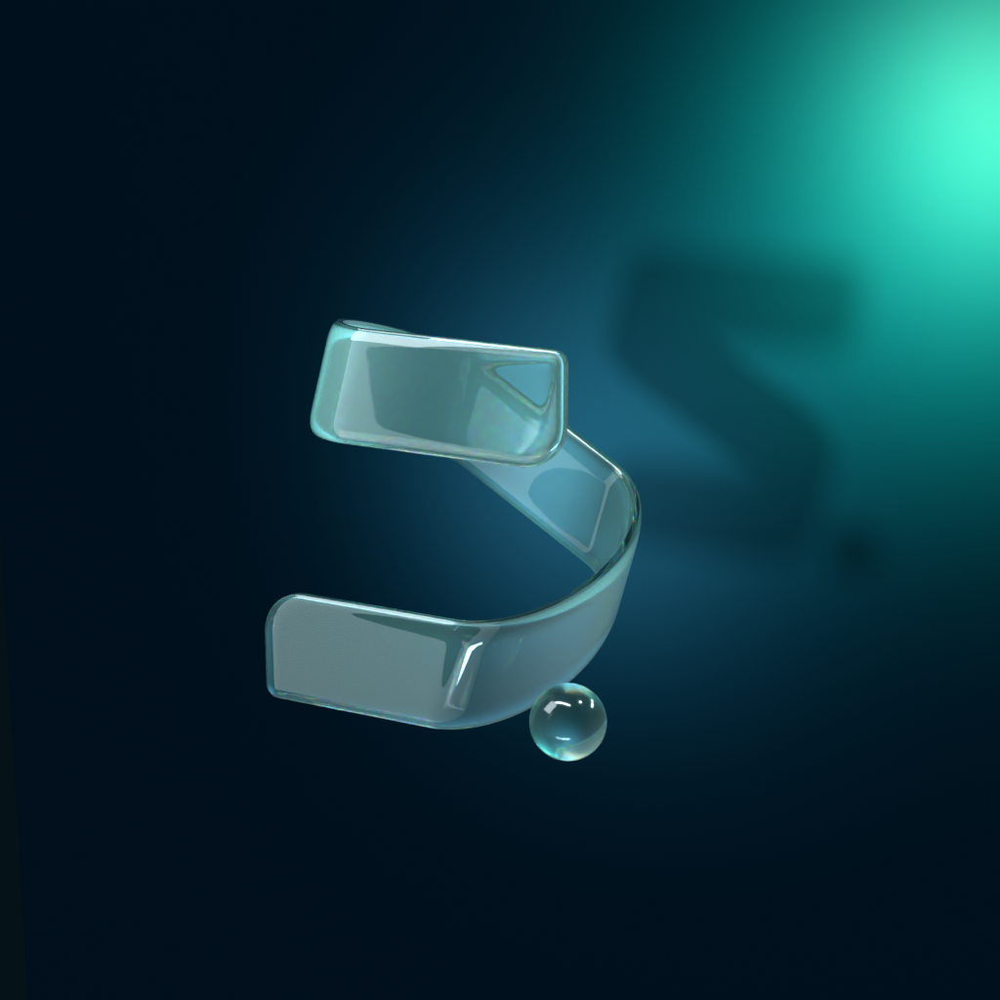

# skil.li — le ruban de verre en 3D

Le S du logo, construit dans Blender comme **un seul ruban continu, réellement plié**, en verre façon *liquid glass* (version en cours : **v2**). Vu de face (caméra orthographique), il redonne la silhouette de `../ribbon-mask.svg` ; vu de biais, c’est une bande de verre pliée en Z. Le point est une sphère de verre du même diamètre que le point du SVG.

## Versions

Rien n’est écrasé : chaque version figée garde ses scripts, sa scène, ses exports et ses rendus.

| Version | Où | Ce qui change |
| --- | --- | --- |
| **v2** (en cours) | ce dossier | Plis 5,6 × plus ronds (rayon de bord 21 au lieu de 3,7), verre clair et épais (8) à bords en lentille, dispersion, liseré net. |
| v1 | `versions/v1/`, tag `brand-3d-v1` | Verre givré « opale » réglé sur le logo du site, plis serrés, verre fin (2). |

Page de comparaison en direct (v1/v2 en three.js, exports, rendus) : `showcase/make_showcase.py`.




## Fichiers

| Fichier | Usage |
| --- | --- |
| `skilli-logo.blend` | Scène complète : ruban, point, matière, halo, éclairage, caméras (face orthographique, biais 85 mm). Cycles. |
| `skilli-logo.glb` | Pour three.js : ruban + sphère, épaisseur et arêtes arrondies appliquées, UV, dégradé de pli en couleur de sommet (COLOR_0), position du reflet en extras, matière glTF (transmission, IOR, clearcoat, volume). 1,4 Mo. |
| `studio-env.hdr` | L’éclairage du studio en equirectangulaire, à brancher sur `scene.environment` : mêmes reflets sur les plis et les arêtes qu’en rendu. |
| `viewer.html` | Référence d’intégration three.js : GLB + environnement sur le shader du halo du site, inclinaison à la souris. |
| `skilli-mark@2x.png`, `skilli-mark.png` | Le S et la sphère **à plat, fond transparent**, 1080 × 1056 et 540 × 528 : même cadre que `../ribbon-glass.svg` (viewBox 270 × 264), donc ils le remplacent tels quels sur le site. Le verre garde la réfraction du halo, sans ombre (le site ajoute la sienne en CSS). |
| `skilli-logo-3d.png`, `skilli-logo-3d-angle.png` | Rendus Cycles 1024², face (même cadrage que `../halo-menthe-glass.png`) et biais. |
| `build_logo.py`, `build_scene.py`, `export_web.py` | Reconstruisent tout dans Blender (dans cet ordre), puis exportent GLB, HDR et PNG transparent. |
| `fit_ribbon.py` | Ajuste la géométrie 3D sur le SVG et imprime les paramètres de `build_logo.py`. |
| `showcase/` | Gabarit et script de la page de comparaison en direct. |
| `versions/` | Les versions figées. |

## La géométrie, et pourquoi

Le SVG dessine le S en trois morceaux qui *suggèrent* un pli. Plié pour de vrai, un ruban ne peut pas reproduire ce dessin avec un simple pli à plat : l’arête haute de la diagonale part forcément du coin du pli, ce qui décale la diagonale d’environ 60 unités vers la droite. La solution retenue :

- **Une bande plate unique** (≈ 631 × 54 unités SVG), **pliée deux fois en Z**. À chaque pli, le ruban s’enroule vers l’arrière autour d’une section en **demi-ellipse** (38 de large, 69 de profondeur en v2 ; 14,7 × 55,3 en v1). C’est une isométrie : aucune déformation, aucune couture. Ce que ferait une vraie bande de verre ou de papier.
- **La profondeur du pli** est ce qui place la diagonale là où le dessin la met. La demi-ellipse donne en plus un départ de courbure doux sur la face et des coins de boucle arrondis. La rondeur ne coûte presque rien en fidélité : à 38 de large, le bord a un rayon de 21 (5,6 × la v1) et la vue de face colle toujours à 95,9 %.
- **Les bandes haute et basse sont dans le même plan, la diagonale 1,4 m derrière** (à l’échelle du fichier, S ≈ 1,9 m). Comme dans `../halo-menthe-glass.png`, ce sont les bandes extérieures qui passent devant la diagonale à chaque boucle. L’objet est symétrique par rotation de 180° autour de l’axe de vue.
- **Fidélité de face : IoU 0,959** avec le masque SVG. L’écart restant vient de la physique : un vrai pli impose que la pente de la boucle soit la bissectrice des deux bandes (15,3° de la verticale), alors que le dessin la penche à 21°.

## La matière

Réglée par comparaison directe avec le logo du site (capture du hero, mêmes points de couleur mesurés), pas seulement avec le PNG du kit :

- **Ce que le verre réfracte, c’est la recette du site.** Les rayons qui traversent le ruban voient le halo à `brightness(1.65) saturate(.72)`, comme la couche `.halo-refraction` de `style.css`. La caméra, elle, voit le halo normal. Les faces suivent donc le halo : cyan clair en haut à droite, bleu-gris en bas à gauche.
- **Liquid glass (v2)** : verre clair (rugosité 0,03), **épais de 8 au centre**, avec un **biseau arrondi** : l’épaisseur tombe en quart d’ellipse sur les 10 dernières unités de chaque bord, extrémités comprises. Vus de face, ces bords sont des bandes en lentille qui courbent le halo, comme les bords des matériaux Liquid Glass d’Apple. **Dispersion** : trois couches de verre (rouge, vert, bleu) à IOR 1,445 / 1,47 / 1,495, d’où une frange colorée là où le verre plie le plus la lumière. Vernis net par-dessus (liseré), 8 % d’« opale » cyan pour garder la teinte du site.
- La v1 utilisait un verre fin (2), givré (0,16) et 28 % d’opale.
- **Le dégradé « fold » du SVG est porté par le ruban** : une couleur de sommet `shade` assombrit la diagonale là où elle sort des plis et l’éclaircit au milieu (arrêts du SVG), adouci à 55 % en v2. Une bande lumineuse douce, invisible à la caméra et fixe, donne le reflet du milieu de la diagonale.
- **Arêtes** : le liseré vient d’un anneau lumineux invisible autour de la caméra, reflété par chaque arête arrondie. L’ombre portée (douce, vers le bas) vient d’un soleil qui n’éclaire que le halo.

Comme demandé dans `../README.md` : les reflets restent attachés aux plis, aucun balayage. Seul le halo bouge (`halo_time`, animé au même rythme que le site).

## Reconstruire

Dans Blender 5.2 (onglet Scripting, ou `blender -b -P …`) : `build_logo.py`, puis `build_scene.py`, puis `export_web.py`. Les scripts ne touchent qu’aux collections `skilli_logo` et `skilli_studio`.

Si le tracé 2D change : `uv run --with numpy --with scipy --with pillow assets/brand/3d/fit_ribbon.py` (nécessite `rsvg-convert`), coller les paramètres dans `P` de `build_logo.py`, reconstruire.

## three.js

`viewer.html` est la référence (three r170, chargé depuis jsDelivr pour l’aperçu ; à embarquer localement en production) :

```sh
python3 -m http.server 8791 --bind 127.0.0.1 --directory assets/brand/3d
```

- **Caméra orthographique**, ou très longue focale. La diagonale est 1,4 m derrière : une perspective ordinaire (FOV 35–50°) la rétrécit et déforme le S.
- **Le halo doit être un mesh de la scène**, derrière le logo, et non un canvas séparé : la transmission de three.js ne réfracte que ce qui est rendu dans la scène.
- `scene.environment = studio-env.hdr` (`EquirectangularReflectionMapping`), sans `scene.background`.
- **Même recette que le site, dans la transmission de three.js** : `viewer.html` modifie le shader de transmission (`onBeforeCompile`). Le halo réfracté est passé à ×1,65 et saturation 0,72, puis viennent la face cyan laiteuse, le dégradé de pli (COLOR_0) et le reflet de la diagonale (placé grâce aux extras `s_from_uv` / `glint_s` du nœud `skilli_ribbon`). En v2 : verre clair (`roughness 0.04`) et `dispersion 4` (native dans three.js). Réglages dans l’URL : `?br=…&milk=…&ro=…&disp=…&env=…`. Vérifié en Chromium (rendu logiciel SwiftShader) ; à revalider sur un vrai GPU et sur mobile.
- La transmission three.js ne voit pas les autres surfaces transmissives : la diagonale n’apparaît pas à travers la bande du haut, comme dans le visuel 2D approuvé.
- Mêmes règles que l’étude 2D : `prefers-reduced-motion`, pause hors écran, `dispose()` au démontage, repli sur le PNG sans WebGL. Le viewer ne gère que la première.

## Animation

- Tout est parenté à l’empty `skilli_logo`, au centre du logo : c’est lui qu’on anime (rotation, entrée…). L’empty est au centre de la profondeur, donc une rotation reste équilibrée.
- UV du ruban : `u` suit la bande déroulée (0 = extrémité haute droite, 1 = extrémité basse gauche), `v` sa largeur. Pratique pour un dévoilement le long du ruban (shader ou masque).
- `halo_time` (nœud du matériau `skilli_halo`) anime le fond ; clé linéaire sur la plage de la scène.
- Le site demande une géométrie immobile, sans rotation permanente. Les mouvements du logo sont donc réservés aux animations ponctuelles (vidéo, intro).
