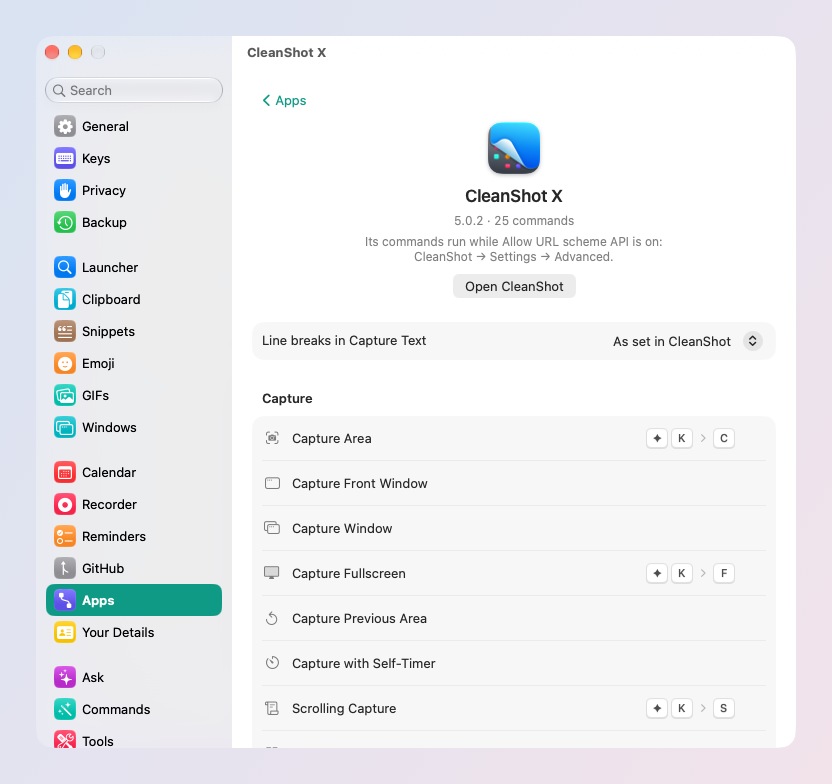

# Apps and GitHub

skil.li drives some apps directly: their commands become launcher rows,
keys, links and things Ask can do. Settings → Apps lists the ones
installed on your Mac, each with its page.

## CleanShot X

Every command CleanShot X documents is in the launcher with its icon:
Capture Area, Window, Fullscreen, Scrolling Capture, Record Screen,
Capture Text, Annotate, Pin, Capture History… skil.li adds a few of its
own: **Capture Front Window** and **Record Front Window** (no window to
pick), **Annotate Latest Screenshot**, **Pin Latest Screenshot** and, for
the file selected in Finder, **Annotate Selected Image** and **Pin
Selected Image**.

- Default keys: ✦K C (Capture Area), ✦K F (Fullscreen), ✦K S (Scrolling
  Capture).
- **⌘K** on a command shows its variants: capture and copy, save,
  annotate, pin or upload; Capture Text with or without line breaks.
- **⌘K on an image** in your clipboard history or in Search Files: Annotate
  in CleanShot, Pin in CleanShot, Add to Quick Access.

**One switch in CleanShot first**: CleanShot X → Settings → Advanced →
*Allow URL scheme API*. While it is off, CleanShot ignores the commands
without a word. Settings → Apps → CleanShot X says so, with a button to
open it.

## Shortcuts

Every shortcut in your Shortcuts library is a launcher row by its name.
↩ runs it, and what it gives back shows in the card. **⌘K → Run with the
Selection** passes the selected text as its input. Give one a key from
its row in Settings → Apps → Shortcuts, or ask "run my morning
shortcut".

## Warp, Zed, Microsoft Teams

The links these apps document are launcher rows too: Warp's settings
pages, Zed's agent settings, a new Teams meeting.

## Any other app

An app that documents its own links (`appname://…`) can be added: ask
your SI ("add Warp's links"), or open a `skilli://apps/import` link
someone shares. skil.li shows the app and every link it opens before you
add it. A command that sends, deletes or calls always asks first. The
files live in `~/Library/Application Support/skil.li/Apps/`.

## GitHub

Your pull requests and notifications in the launcher: type `pr`.

- Pull requests in four groups (ready to merge first, when you can merge),
  then your unread notifications.
- **↩** opens one. **⇥** merges (asked twice), updates the branch or
  shows the checks. **⌘⌫** marks a notification read.
- A strip under the launcher's search field shows what waits for you.

Sign in once in **Settings → GitHub**: skil.li opens GitHub in your
browser with a code to confirm. Live updates and **Server sync** (one
copy of your inbox for all your Macs, off by default) are set there too.

### Start a workflow and follow it

A GitHub Actions workflow you start by hand (a release, a deploy) can be
started from skil.li: a skillie, a `skilli://github/workflow` link or
your agent. skil.li asks once in its card, naming the workflow and what
it is given; your ↩ also approves its environment when you may. Then a
box in the menu bar shows the step it is on: click it for every step,
**Open on GitHub** or **Cancel Run**. A card says at the end where the
release is, or which step failed. How to write the skillie:
[Skillies, links and agents](skillies.md) and the
[collection's recipe](https://github.com/nomdelasociete/skilli/blob/main/skillies/README.md#start-a-github-workflow-and-follow-it).
