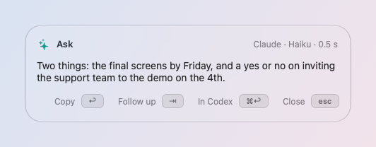
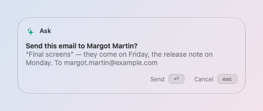

# Ask

Say what you want, in your own words, from any app. skil.li answers, or
does it for you.

## Ask something

Press **✦A** (or type in the launcher, then **⇥**) and say it:

- "what's 15% tip on 64 euros" → it answers in a card.
- "make this more polite" with text selected → it rewrites the
  selection, and ↩ puts the new text in place.
- "open my Downloads folder", "quit Slack", "dark mode" → it does it.
- "timer 10 minutes for the tea", "keep my Mac awake until 6pm" → done.
- "lunch with Margot tomorrow at 1pm", "remind me to call Camille at
  9am" → an event, a reminder.
- "write to Jean-François that I'll be late" → a new mail to that
  contact.

It reads what you mean, not a fixed phrase. If something is missing (how
long, which app, when), the card asks just that; answer it and the rest
is kept. Unsure between two things, it asks which.

## The card

- Answers are written as they come, with formatting.
- **⇥** asks a follow-up in the same conversation.
- **↩** does what the card offers (put the text in place, run the
  action).
- **⌘↩** continues the conversation in Claude Code or Codex.
- **esc** closes it; nothing has changed.

## By voice

- **Ask by Voice** (✦V): say it; the words appear as you speak, ↩ runs
  it.
- **Dictate** (✦D): types what you say into any app, knowing your
  contacts' names.

Speech is turned into text on your Mac.

## When it acts for you

What can be taken back happens at once, with ⌘Z right after. What cannot
(quitting an app with unsaved work, sending, deleting, a menu item that
closes something) waits for your ↩ in the card.

- **Do It Here**: "fill this form with my details", "pick the earliest
  delivery slot", on the window in front. skil.li clicks and types for
  you, step by step, and asks before risky steps. Your personal details for forms live in Settings →
  Your Details; sensitive ones stay in the Keychain and are asked for
  once, for the whole form.
- **Your Rules** (Settings → Ask → *When It Acts*): what agents may do,
  in your words, as Allow, Ask First or Never ("never send an email
  without asking me"). Checked before each step.

## On a schedule

"Every Monday at 9am sum up my pull requests": Ask runs it then, and
shows the result. Your scheduled requests are listed in Settings → Ask →
*On a Schedule*, to change or remove.

## What it uses

Ask chooses what to do with your TypeSafe Jev key (or OpenAI), and writes
answers with your Claude or ChatGPT. Without a choosing key, it waits for
Claude Code or Codex to choose, which is slower. What leaves your Mac for
each request is listed in Settings → Privacy. See
[Your SI and privacy](privacy.md).
