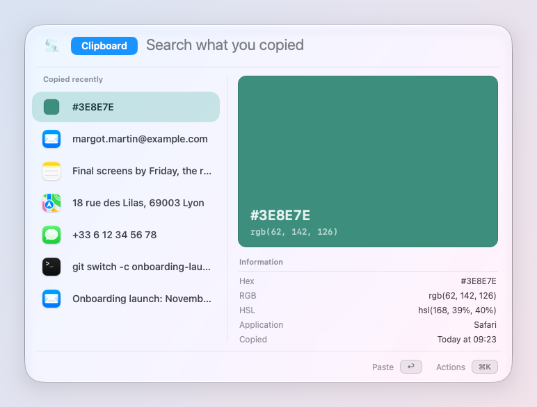
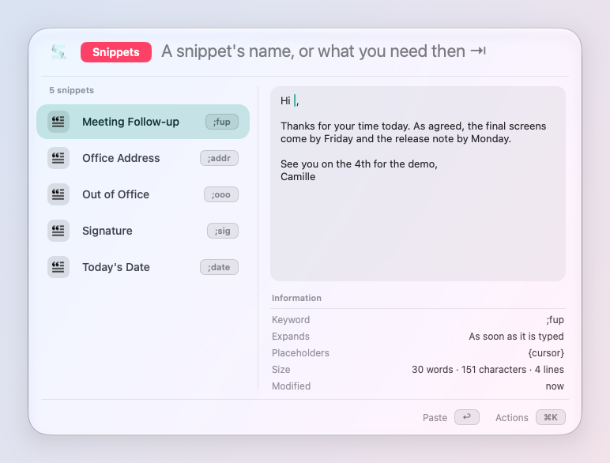
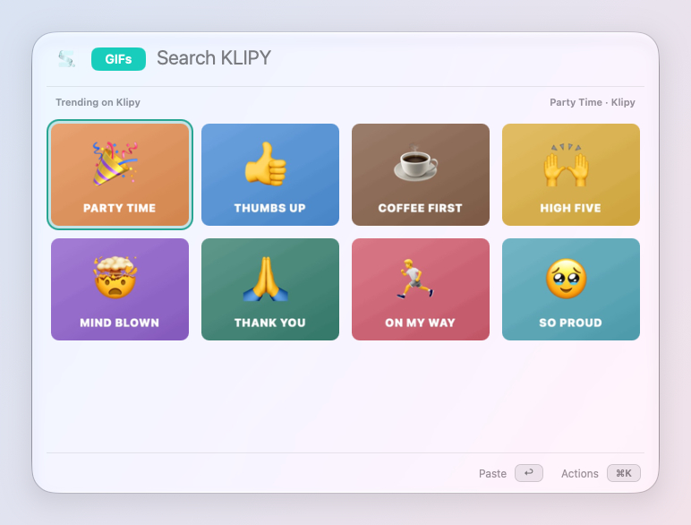

# Clipboard, snippets and emoji

Everything you copied, the text you type often, every emoji and symbol,
and GIFs: typed where you are, in the app you are in.

## Clipboard History

**✦C** at first (its key is yours to change), or `cb` in the launcher,
shows what you copied: text, links,
images, files, and your screenshots too.

- **↩** pastes it in the app you were in. **⇧↩** pastes it as plain text,
  **⌘↩** only copies it.
- **Search** by the words, without worrying about accents, even words
  inside images. **⇥** searches by meaning: "my train ticket from
  yesterday".
- **The preview** beside the list shows each copy as what it is: a link
  as a card (picture, title, site), a color as a swatch with its Hex, RGB
  and HSL, an image with the text in it, a file's thumbnail.
- **⌘⌫** forgets one. Changed your mind? **⌘Z** brings it back for 10
  seconds.

Passwords that password managers mark as secret are never kept. Settings
→ Clipboard: how long copies are kept, whether screenshots are kept too,
and the apps whose copies are never kept (*Never keep copies from*).

Two more ways to paste:

- **Paste in Sequence** (✦K V): your last copies, one after the other, a
  key each, newest first. Copy five things, paste them in five places.
- **Paste Latest Screenshot**: your last screenshot, in the app in front.

## Snippets

Text you type often (an address, a signature, an IBAN, a reply), saved
once.

1. Type `new snippet` in the launcher, or open Settings → Snippets.
2. Write the text, give it a name and, if you want, a **keyword**
   (`;addr`).
3. Type the keyword anywhere: skil.li replaces it with the text, at once
   or after a space or ↩ (Settings → Snippets → *Expand*).

A snippet can hold placeholders: `{date}` for today, `{clipboard}` for
what you copied, `{cursor}` for where the caret lands. Keywords never
expand in password fields.

**Search Snippets** (`snip` in the launcher) lists them beside a preview
of the snippet as it would type now. ↩ types it, ⌘↩ copies it, and **⇥**
finds one by what you need ("my iban").

## Emoji and symbols

**⌃⌘Space** at first (it replaces macOS's Emoji & Symbols), or `:` in the
launcher.

- Type a name, in your language or in English. **←→↑↓** move, ↩ types
  it, ⌘↩ copies it.
- **Symbols too**: ⌘ ⌥ ⇧, the Apple logo, « », →, ≠, €, ✓, by their names
  or the words people use ("cmd", "arrow"). Beside a symbol, the keys
  that type it on your keyboard, so next time you need no picker.
- **By feeling**: describe it ("so happy but exhausted"), then ⇥. An
  emoji picked that way comes at once next time for the same words.
- **Skin tone**: Settings → Emoji.

## GIFs

`gif` in the launcher, then a few words: GIFs from Klipy, then the ones
on your Mac whose name has the words. The selected one plays. **↩**
pastes it animated (as a Markdown link in a terminal or code editor),
**⌘↩** copies it, **⇧⌘C** copies its link.

