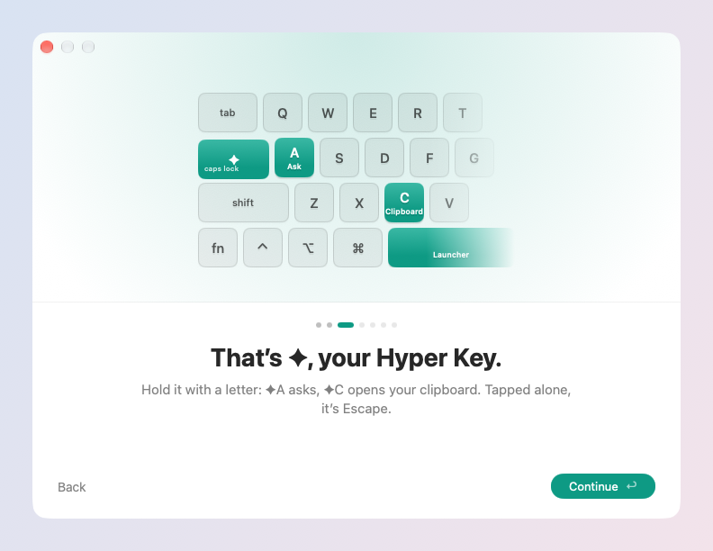

# Getting started

Install skil.li, give it one permission, and learn the three keys that
reach everything else. About a minute.

## 1. Install

skil.li runs on macOS 26 or later. Download it from
[skil.li/download](https://skil.li/download), open the disk image and drag
skil.li to Applications. Or, with Homebrew:

```bash
brew install --cask nomdelasociete/tap/skilli
```

It is signed and notarized by Apple, and it keeps itself up to date (to
check now: **Check for Updates…** in the menu bar's skil.li menu). It is
free and open source; there is no account to create.

## 2. The welcome

The first launch opens a short welcome. Every step is something you do,
not something you read, and you can skip any of them.



1. **One switch.** Continue opens System Settings at the Accessibility
   list (Device Control and Data Access from macOS 27), with a small guide
   next to it: turn on skil.li. The welcome moves on by itself. This is
   the only permission it asks for now. Each other one (Calendar,
   Contacts, the microphone…) is asked by macOS where you first use what
   needs it.
2. **The Hyper Key.** Hold Caps Lock: it is ✦ now. With a letter it runs
   skil.li's shortcuts (✦A asks, ✦C opens your clipboard); tapped alone,
   it is Escape. If Caps Lock already has a mapping of yours, it is left
   as it is.
3. **The launcher's keys.** Choose ⌘Space (instead of Spotlight,
   recommended), ✦Space, or keys of your own, then press them: the
   launcher opens. Type a few letters, then esc.
4. **Your SI.** skil.li writes with the Claude or ChatGPT you already pay
   for, and chooses with a TypeSafe Jev key. See [Connect your SI](#4-connect-your-si).
5. **Try it on text.** A sentence full of mistakes is selected. Press ✦K,
   then G: the fix shows in a card, ↩ puts it in place, ⌘Z takes it back.
6. **Set up.** What the welcome turned on, a line each. A missing line
   says where to set it later.

Closed early, the welcome never comes back by itself. Type `welcome` in
the launcher to see it again; while Accessibility is off, the menu bar's
skil.li menu also offers **Set Up skil.li…**.

## 3. The three keys to remember

| Keys | Does |
| --- | --- |
| ✦Space (or the keys you chose) | Opens the launcher: apps, files, commands, everything |
| ✦A | Ask: say what you want, in your words |
| ✦C | Your clipboard history |

Everything else is one search away: type `?` in the launcher for the
Catalog, every command skil.li has with its keys. Every row also has
**⌘K**, the actions it can take, including Set Shortcut….

## 4. Connect your SI

SI is skil.li's name for the AI it uses. It is yours, and it is optional:
everything that is not SI (the launcher, the clipboard, snippets, windows,
the Hyper Key…) works without it.

- **To write** (answers, rewrites, summaries): your Claude subscription
  through Claude Code, a Claude API key, your ChatGPT subscription through
  Codex, or an OpenAI API key. With Claude Code or Codex installed and
  signed in, skil.li finds them by itself.
- **To choose** (what Ask does, search by meaning, Do It Here): a TypeSafe
  Jev key, recommended, or an OpenAI key.

Set them in **Settings → SI Accounts**; Verify tests each one. No credits,
no account with us: what you pay for stays between you and your provider.
Only what a request needs leaves your Mac, and Settings → Privacy lists
every case. More in [Your SI and privacy](privacy.md).

## 5. Where to go next

- [The launcher](launcher.md): everything you can find and do from one field.
- [Your text, anywhere](writing.md): fix, translate and rewrite the selection in any app.
- [Hyper Key and shortcuts](keys.md): give any command a key of your own.
- [Windows](windows.md): put windows in place with ✦W.

Something does not work? [Troubleshooting](troubleshooting.md).
