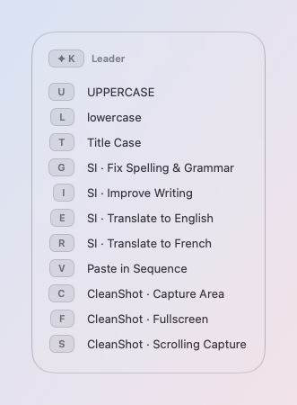
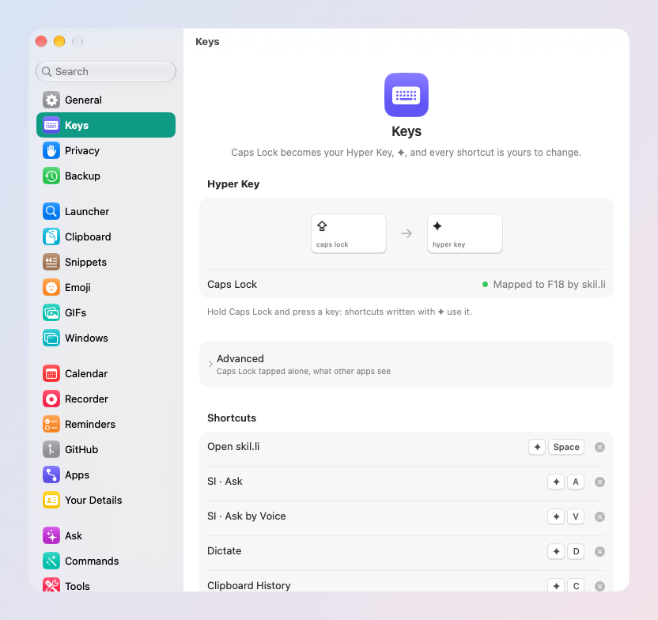

# Hyper Key and shortcuts

Caps Lock becomes a key of your own, ✦, and any command gets a shortcut:
one key, or a short sequence you can remember.

## The Hyper Key

Hold **Caps Lock**: it is ✦, the Hyper Key (⌘⌃⌥⇧ at once, a combination
apps almost never use). With a letter, it runs a skil.li shortcut. **Tapped alone,
it sends Escape**, handy in Vim and in any dialog.

- It works alongside Raycast's own Hyper Key: both apps get it.
- If Caps Lock already has a mapping of yours (Karabiner, for example),
  skil.li leaves it alone; choose another Hyper Key in Settings → Keys.
- Settings → Keys → Advanced: turn off *Tap Caps Lock alone to send
  Escape*.

## Keys and sequences

A shortcut is one key (✦A) or a sequence (✦K, then G). After the first
key of a sequence, a panel shows what comes next, so you never have to
learn them by heart.

These are the keys skil.li starts with; each one is yours to change or
remove:

| Keys | Does |
| --- | --- |
| ✦Space | Open the launcher |
| ✦A | Ask |
| ✦V | Ask by Voice |
| ✦D | Dictate into any app |
| ✦C | Clipboard History |
| ⌃⌘Space | Search Emoji |
| ✦U | UPPERCASE the selection |
| ✦K U · L · T | UPPERCASE · lowercase · Title Case |
| ✦K G · I | Fix Spelling & Grammar · Improve Writing |
| ✦K E · R | Translate to English · Translate to French |
| ✦K V | Paste in Sequence |
| ✦K C · F · S | CleanShot X: Capture Area · Fullscreen · Scrolling Capture |
| ✦W, then a key | Place the window in front (see [Windows](windows.md)) |
| ⌘, in the launcher | Open Settings |

Every one of them can be changed or removed.

## Give anything a key

Three ways, from where you are:

1. **In the launcher**: select the row, ⌘K → **Set Shortcut…**, press
   the keys.
2. **Where the thing lives in Settings**: a skillie (Settings →
   Skillies), an app's command (Settings → Apps), any Catalog entry
   (Settings → Catalog). Click **Record Shortcut**, press the keys; esc
   cancels.
3. **Settings → Keys → Add Shortcut…**: type a few letters of anything
   (a command, a layout, a snippet, a quicklink, a System Settings pane,
   a sound device, a Shortcut, an app), ↩, then click its row to record.

To record a sequence, press the first keys, then the next one: ✦K, then
P.

## No clashes

A shortcut is refused when macOS, the launcher or another skil.li
shortcut already uses its keys. The refusal says who holds them and
where to turn that off. Two exceptions, each doing what the macOS one
did: Search Emoji may take ⌃⌘Space from Emoji & Symbols, and the
launcher may take ⌘Space from Spotlight (skil.li turns Spotlight's
⌘Space off, and back on if the launcher moves to other keys).

Settings → Keys lists every shortcut in one place, whatever it runs.

