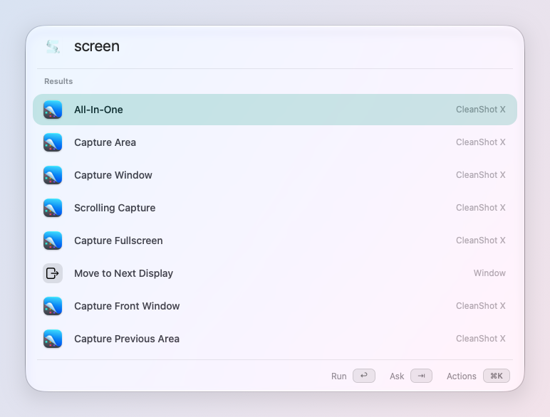
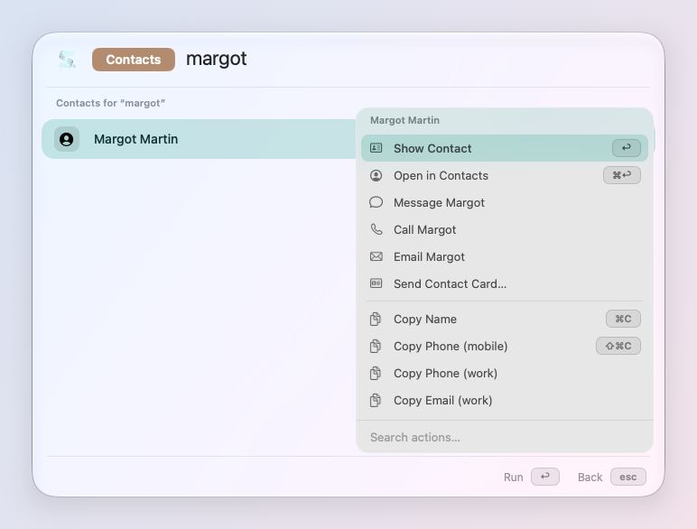

# The launcher

One field for everything: apps, files, commands, what you copied, your
calendar, your Mac. Open it from anywhere with the keys you chose in the welcome: ⌘Space,
✦Space (Caps Lock held, then Space) or your own.

## Find anything

Type a few letters. The search forgives typos and learns what you pick:
the result you chose last time for the same letters comes first, and a
name typed whole beats everything.

- **↩** does what the selected row does. The footer names it: "Open ↩",
  "Paste ↩", "Join ↩".
- **⌘↩** does its second action (for a file: show it in Finder).
- **↑ ↓** or **⌃N ⌃P** move. **↑** in the empty field brings back your
  recent searches.
- **⌘C** copies the row's value (a file's path, a color's hex, a result).
- **esc** steps back: out of a mode, then closes.

The launcher remembers where you drag it (guides pull it to the middles);
**Reset Launcher Position** puts it back.

## ⌘K: everything a row can do

Every row has actions. Press **⌘K** on it to see them, with their keys:

- what the row itself can do (Quit and Force Quit on a running app,
  Annotate on an image, Join on a meeting…);
- **Set Shortcut…**: give it a key of your own;
- **Set Alias…**: a short name of yours ("cs" for CleanShot X);
- **Pin**: keep it first;
- **Copy Link**: a `skilli://` link that runs it from anywhere (Shortcuts,
  a Stream Deck, a web page).

## Modes

A few letters and a space switch the launcher to one kind of thing. A
chip shows the mode; esc leaves it.

| Type | To search |
| --- | --- |
| `?` | The Catalog: everything skil.li can do, with its keys |
| `cb` | Your clipboard history (also ✦C) |
| `snip` | Your snippets |
| `:` | Emoji and symbols (also ⌃⌘Space) |
| `gif` | GIFs, from Klipy and your Mac |
| `f` | Your files, cloud drives included (not your projects' dependencies) |
| `tab` | Tabs open in Safari, Chrome, Arc, Brave, Edge… |
| `hist` | Your browser history |
| `@` | Contacts |
| `m` | The menus of the app in front ("m export pdf") |
| `cal` | Your coming events |
| `todo` | Your reminders |
| `pr` | Your GitHub pull requests and notifications |
| `brew` | Homebrew formulae and casks |
| `kill` | Running apps and what listens on a port |
| `recs` | Your meeting recordings |

In the clipboard, files, browser history, snippets and emoji, **⇥**
searches by meaning instead of by name: "my train ticket from yesterday",
"the invoice from the plumber". The clipboard, browser history and
snippets look through everything they keep, not only the latest. In
Search Files it does so on its own
when no file is named like what you typed. That needs your SI's choosing
key (see [Your SI and privacy](privacy.md)).

## Without a mode

Some things need no prefix at all:

- **Math and units**: `12% of 840`, `5 km in miles`, `time in Tokyo`. ↩
  pastes the result in your app, ⌘↩ copies it.
- **Currencies**: `800 TRY` (in your currency), `100 usd in €`,
  `49 £ en dollars`, `120 € + 30 $`, `49 $ * 12`, answered as you type
  at the day's central-bank
  rates; the row says the rate and its day. Select a price (`$1,299`)
  and open the launcher: its conversion comes first. Converted on your
  Mac: only the day's table of rates is downloaded.
- **System Settings panes**: "displays", "bluetooth", "night shift".
- **Projects**: the recent folders of Cursor, VS Code, Windsurf, Zed,
  Sublime Text and JetBrains; ↩ opens it in its editor.
- **Windows**: any open window, by its title or its app (Switch Window).
- **Mac commands**: Lock Screen, Keep Awake, Empty Trash, Volume… See
  [Your Mac](mac.md).
- **Quicklinks**: `g skilli` searches Google, `yt lofi` YouTube. With
  text selected and no query typed, the selection is the query. Add your
  own in Settings → Catalog → Quicklinks (or Add from Library…).

Not what you meant? **⇥** hands what you typed to [Ask](ask.md), which
reads it as a request.

## Make it yours

- **Settings → Launcher**: its keys, where it opens, whether it starts
  empty again.
- **Settings → Catalog**: hide an entry from search, your aliases, your
  quicklinks, the links you trusted.
- **Settings → Keys**: a key for any row (see [Hyper Key and shortcuts](keys.md)).
