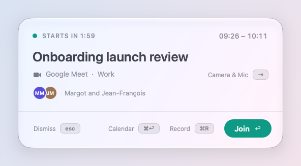
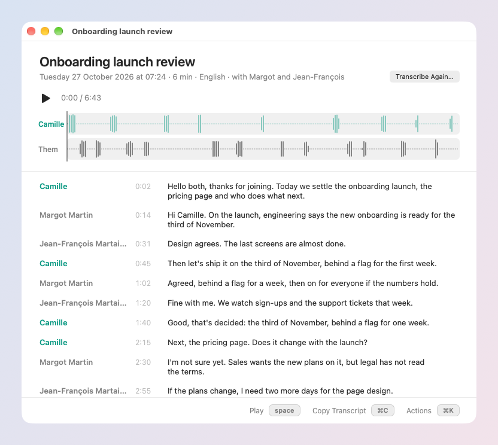
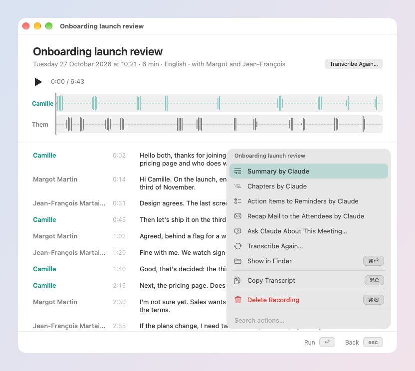

# Meetings

Your next meeting one key away, a nudge before it starts, and, when you
want it, a recording written out on your Mac.

## Your calendar

skil.li reads the calendars of your Mac (System Settings → Internet
Accounts: Google, iCloud, Exchange…). The first time, macOS asks to let
it.

- **In the menu bar**: the next meeting, "in 12 min" before it, a red
  camera when it started and you have not joined, "20 min left" during
  it.
- **In the launcher**: in the minutes before a meeting, it is the first
  row before you type. ↩ joins the call.
- **`cal` in the launcher**: your coming events. ↩ joins, ⌘⌫ deletes one
  (⌘Z brings it back; one with invitees asks first).
- **Add an event** in your words: `event lunch with Margot tomorrow 1pm`,
  or ask "block two hours for focus on Thursday morning".
- **Copy Availability**: your free time in the next five working days,
  ready to paste in a mail.

## Before it starts

A card comes up before a meeting (or the screen dims, as you choose in
Settings → Calendar → *Alerts*): its title, who is in it, and:

| Key | Does |
| --- | --- |
| ↩ | Join the call |
| ⇥ | Check Camera & Mic: your camera live and your microphone's level |
| ⌘R | Record it, then join |
| ⌘↩ | Open the event in your calendar |
| esc | Dismiss |

No card once you are already in the call, and a card still up goes away
as you join.

## Record a meeting

The recorder takes your microphone and your Mac's sound (the other side
of the call), as two tracks, and writes them out on your Mac when you
stop. Nothing leaves your Mac.

**Start it** with **⌘R** where the meeting already shows: its card, its
row in the launcher, or its menu in the menu bar once you are in the
call. Or type `rec` in the launcher (`rec Weekly sync` to name it). It
never starts by itself, and the first time it reminds you that the
others must agree to be recorded.

**While it records**, a red dot in the menu bar shows the time and both
sides' sound. Its menu pauses, resumes, stops, or turns a source off.
When the call app leaves the call, or the meeting is over and quiet for a
minute, a card offers to stop.

**Webcam and screen** are off until you turn them on, from the card or
the red dot's menu: the meeting's window is recorded with the sound, and
the text on the slides is read and kept with its time.

## After the meeting

The recording opens in its own window: both sides' waveforms, and the
transcript line by line, **Me** and **Them** (each voice on its own lines:
Them 1, Them 2…, until you name them).

- **Click a line** to play from there.
- **Name a speaker**: click the name (or ⌥↩), pick from the attendees.
- **Fix a line**: select it, ↩ edits its words, ⇥ gives it to the next
  speaker, ⌘⌫ deletes it. ⌘Z undoes.
- **⌘K** for more, sent to your SI only when you pick it, and only the
  words: **Summary**, **Chapters**, **Action Items to Reminders** (each
  linked back to when it was said), **Recap Mail to the Attendees** (a
  draft in your mail app; you send it), **Ask About This Meeting**
  ("what did we decide about the launch date?"), answered from the
  transcript with who said it and when. A recording's row in `recs` has
  Ask in its ⌘K too.
- **Your skillies for recordings** are in the same ⌘K: one runs on this
  recording's folder (its sound, pictures and transcript), its card
  showing how it went. The one picked to run after each transcript is
  said in the window: when it ran, and its last line.

**Better transcription**: Settings → Recorder offers a 1.6 GB download
(whisper large-v3-turbo) that runs on your Mac: about 40% fewer errors
than macOS's own engine, and it knows the attendees' names.

**Find it later**: `recs` in the launcher searches recordings by title,
date, attendees, and the words said. **Rename…** in a recording's ⌘K (or
on its row in `recs`) renames it and its folder. **Import Recording**
(`import`, or drop a file on a recording's window) turns a voice memo or
another app's recording into one; while a meeting records, its
transcript waits for that meeting's.

**A transcript that could not be made** says why in its window, with the
engine and the language to try, then Transcribe ↩. macOS's engine also
covers the languages of macOS's dictation (Dutch, Polish, Swedish…).

## Settings

- **Settings → Calendar**: what the menu bar shows, alerts (with *Try*),
  where events and Google Meet open, calendars to leave out.
- **Settings → Recorder**: microphone, the Mac's sound, webcam, screen,
  language, engine, where recordings are kept and when they are deleted.
  *After each transcript* is off until you pick a skillie there: it then
  gets every recording from now on, once its transcript is written (⌘Z
  takes it back).
