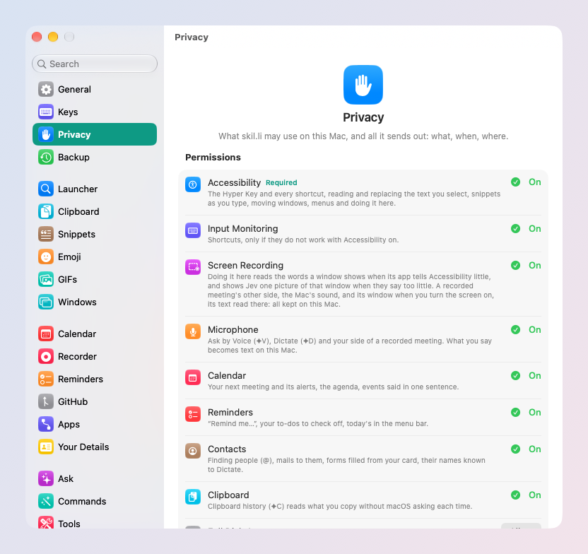

# Your SI and privacy

skil.li uses the SI you already pay for, sends out only what a request
needs, and shows you every case. No account with us, no credits, no
telemetry.

## Your SI

SI is skil.li's name for the AI it uses. It has two jobs, and you bring
your own for each. Set them in **Settings → SI Accounts**; **Verify**
tests each one.

| Job | What it does | With |
| --- | --- | --- |
| Writing | Answers, rewrites, translations, summaries | Your Claude subscription (through Claude Code) or a Claude API key; your ChatGPT subscription (through Codex) or an OpenAI API key |
| Choosing | What Ask should do, search by meaning (⇥), Do It Here | A TypeSafe Jev key (recommended), or an OpenAI key |

- With **Claude Code** or **Codex** installed and signed in, skil.li finds
  your subscription by itself: nothing to paste.
- Keys you paste are kept in your Mac's Keychain.
- Each command can use a model of its own (Settings → Commands).
- Without a choosing key, nothing is found by meaning, Do It Here stops,
  and Ask waits for Claude Code or Codex to choose, which is slower.

Providers charge you for what you use with them, as they always do;
skil.li adds nothing.

## What leaves your Mac

Only what a request needs, and only to the provider you chose.
**Settings → Privacy → What Leaves This Mac** lists every feature that
sends anything, grouped by where it goes (Claude, ChatGPT, OpenAI,
TypeSafe Jev, GitHub, your servers, websites, Apple): what, when, and
whether its switch is on. Each Settings pane also ends with its own line
of it.

Stays on your Mac:

- your clipboard history and snippets;
- speech for Ask by Voice and Dictate;
- meeting recordings and their transcripts (a summary or action items
  send the words to your SI only when you pick them);
- where your windows go;
- your backups.

## Permissions

macOS asks before skil.li can use each part of your Mac. The welcome asks
only for Accessibility; each other permission is asked the first time you
use what needs it.

| Permission | For |
| --- | --- |
| Accessibility | skil.li to work: its keys, reading and replacing the text you select |
| Input Monitoring | Shortcuts |
| Screen Recording | Acting in your apps (Do It Here), recording a meeting's screen |
| Microphone | Ask by Voice, Dictate, recording meetings |
| Camera | Checking your camera before a meeting, and recording it |
| Calendar, Reminders, Contacts | Your meetings, reminders and contacts |
| Clipboard | Keeping what you copy in other apps |
| Bluetooth | Connecting your AirPods and other devices |
| Full Disk Access | Searching Safari's history |

**Settings → Privacy → Permissions** shows each one live, with what it
turns on and its one button.

## Back up

**Settings → Backup** saves your settings and files (snippets, commands,
layouts, skillies…) to a folder you choose, now or on a schedule, and
restores from one. Never your clipboard history, nor your meeting
recordings. Also from the launcher: **Back Up skil.li Now**.

## Open source

skil.li is free software under the GPL-3.0. Every line is on
[GitHub](https://github.com/nomdelasociete/skilli), so anyone can check
what it does.
