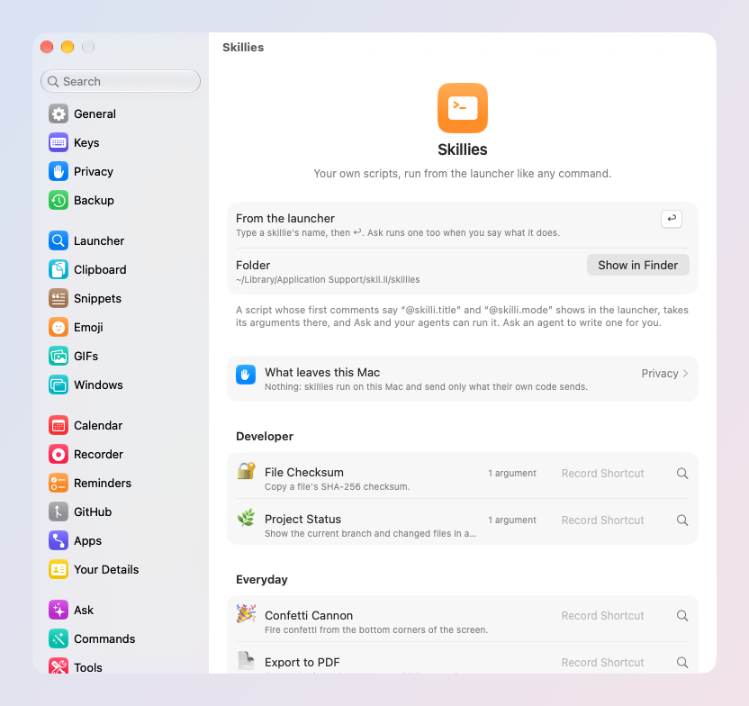

# Skillies, links and agents

Make skil.li do more: a script of yours becomes a command, any command
runs from a link, and your SI agents can use skil.li too.

## Skillies: your scripts as commands

A skillie is a script (shell, Python, AppleScript, JavaScript…) with a
small header: its title, its arguments, how its output shows. skil.li
lists it in the launcher like any command, so it runs from a key, Ask or
an agent.

- **Add one**: browse the [collection](https://skil.li/skillies/) and
  download one, then double-click the `.skilli` file. Settings →
  Skillies shows it whole (where it came from, every line) before you
  add it with ↩. Nothing runs when it is added.
- **Write one**: put a script in the skillies folder,
  `~/Library/Application Support/skil.li/skillies` (Settings → Skillies →
  Show in Finder), or ask an agent to write one for you. The header is
  described in the [Skillies docs](../../skillies/docs/README.md).
- **Give it a key**: click **Record Shortcut** on its row in Settings →
  Skillies.
- **In the menu bar**: a skillie can keep its last line there, refreshed
  on its own (a price, a build status, a counter).
- **For recordings**: one whose header says `@skilli.forRecordings true`
  is in a recording's ⌘K and gets that recording's folder. Settings →
  Recorder → *After each transcript* can run one on every new recording
  (off until you pick one).

## Links: run anything from anywhere

Every Catalog entry has a link. In the launcher, select it, then **⌘K →
Copy Link**: `skilli://run/…`. Put it in Shortcuts, a Stream Deck button,
a note or a web page; opening it runs that command.

What could change your Mac asks first. **Always** (⌘↩ in that card)
trusts that one link from then on; Settings → Catalog → *Trusted Links*
lists them, to take back. Some are never trusted: Empty Trash, Restart,
Shut Down, Log Out, Quit All Apps, Quit Other Apps, settings, and
pastes of your copies.

`skilli://do?app=TextEdit&goal=…` does what the goal says in that app,
the way Ask's Do It Here would. It asks first, unless you chose
**Always** for that goal in that app.

## Agents: skil.li for Claude Code, Codex and others

skil.li is an MCP server: an agent you use (Claude Code, Codex, Cursor,
any MCP client) can read your selection and clipboard, open apps, place
windows, add events and reminders, search your contacts, run your
shortcuts and skillies… through skil.li.

- **Settings → Tools** lists every tool, each with its rights: Default,
  Always Ask, Always Allow or Block.
- **Your Rules** (Settings → Ask) apply to agents too: "never send an
  email without asking me".
- **Your recordings**: an agent can list them (titles, dates, lengths,
  never the words). Reading a transcript asks you every time,
  naming the recording; there is no Always Allow for it.
- **Connected Servers**: the MCP servers your commands and Ask may use,
  imported from Claude Code, Claude for Mac, Codex and Cursor.

For script authors, every skil.li feature a skillie can call is in
[Calling skil.li](../../skillies/docs/calling-skilli.md).
