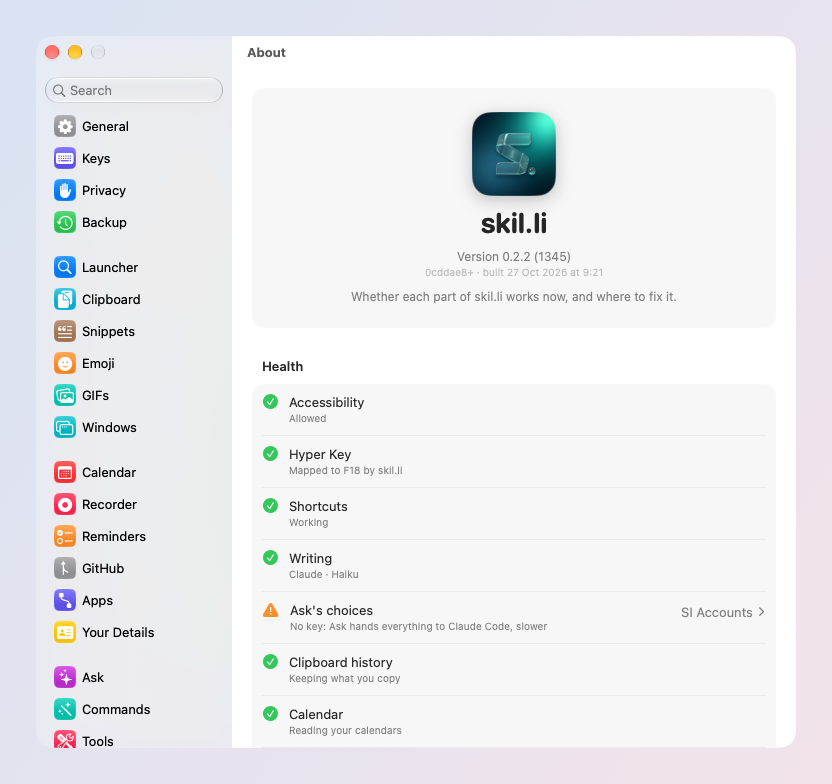

# Troubleshooting

Something does not work? Start with Health, then look for your case
below.

## Health

**Settings → About → Health** has one line per part of skil.li: whether
it works now, and where to fix it when it does not. Most problems are
named there, with the button that fixes them.

## Common cases

**The Hyper Key or my shortcuts do nothing.**
skil.li needs Accessibility. Open Settings → Privacy → Permissions, or
System Settings → Privacy & Security → Accessibility, and turn on
skil.li. If it is on but still nothing happens, turn it off and on
again: macOS sometimes keeps an old grant after an update.

**Caps Lock still turns on capitals.**
Another app may already remap Caps Lock (Karabiner, for example); skil.li
leaves a custom mapping alone. Choose your Hyper Key in Settings → Keys.

**⌘Space still opens Spotlight.**
Choose ⌘Space again in Settings → Launcher: skil.li turns Spotlight's own
⌘Space off when it takes it.

**A shortcut is refused.**
Its keys are already used by macOS, the launcher or another skil.li
shortcut. The refusal says which and where to turn it off; or pick other
keys.

**Ask, commands or a summary say the SI is not connected.**
Open Settings → SI Accounts and press **Verify**. With Claude Code or
Codex, run `claude` or `codex` once in Terminal to sign in.

**Search by meaning (⇥) finds nothing.**
It needs a choosing key: TypeSafe Jev or OpenAI, in Settings → SI
Accounts.

**CleanShot X commands do nothing.**
Turn on CleanShot X → Settings → Advanced → *Allow URL scheme API*.

**My calendar, reminders or contacts are empty.**
macOS asked once and the answer was no. Turn skil.li on in System
Settings → Privacy & Security, under Calendars, Reminders or Contacts.

**I deleted something by mistake.**
Press ⌘Z within 10 seconds: a copy, a snippet, a command, a reminder, a
file moved to the Trash comes back.

## Report a problem

1. **Settings → About → Copy Diagnostics**: your version, macOS and the
   Health lines. Nothing personal.
2. Open an [issue on GitHub](https://github.com/nomdelasociete/skilli/issues)
   and paste it, with what you did and what you expected.

Every feature, with its exact rules and settings, is listed in
[Features](../../docs/FEATURES.md).
