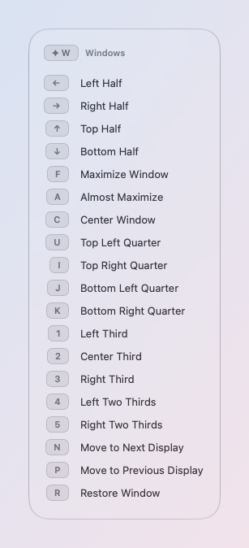
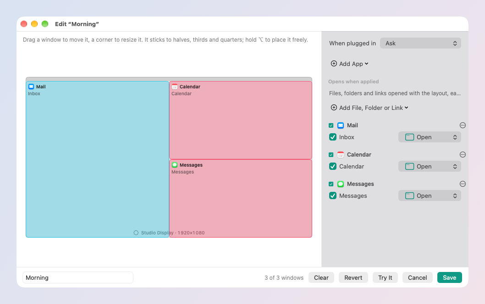
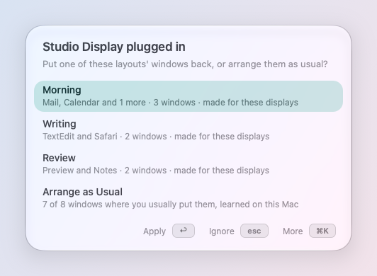

# Windows

Put the window in front where you want it with one key, save
arrangements of every window and bring them back by name, and let
skil.li learn where you put your windows so it can put them back for
you. Everything here works on your Mac only.

## The window in front

Hold the Hyper Key (✦, Caps Lock held), press W, then a key:

| Key | Place |
| --- | --- |
| ← → ↑ ↓ | Left, right, top or bottom half; again within a second and a half: ⅔, then ⅓ |
| U I J K | The quarters, as they sit on the keyboard |
| 1 2 3 | Left, center, right third |
| 4 5 | Left or right two thirds |
| F | Maximize Window (again puts it back) |
| A | Almost Maximize |
| C | Center Window |
| N P | Move to Next Display, Move to Previous Display |
| R | Restore Window: back where it was before skil.li moved it |

The same places are in the launcher ("left half", "moitié gauche") and
in Ask. Settings → Windows → *Space between windows* leaves a gap
between windows and at the screen's edges.

## Saved layouts

**New Window Layout** ("save layout Coding" in the launcher) takes every
window open, minimized and full screen too, and shows them in an editor
on your displays before saving: move them, leave apps out, then ↩.
**New Empty Window Layout** starts from nothing: add apps, files,
folders and links. Typing the layout's name in the launcher puts every
window back, opening the apps and files that are not open. Each display
is known by who it is (its serial), never by its name alone.

When a display is plugged in, skil.li asks, in the middle of that
display, which of its layouts to put back (↩ applies, esc ignores it
once, ⌘K for the rest: always, never, ignore this monitor, edit, record a
new one). A display coming back after sleep is not a display plugged in.

## Windows that go where you put them

skil.li watches where you put your windows and puts them back there for
you: all at once when you ask (**Arrange Windows**), when you plug a
display in (**Arrange as Usual**), and, if you turn it on, each new
window as it opens (**Usual places**). There is nothing to set up: you
use your Mac as usual and skil.li learns. Nothing leaves your Mac.

### What it learns, and when

A place is learned when you move or
resize a window yourself and then leave its app (skil.li reads the
app's windows as it comes to the front and again as you switch away),
and each time you place a window with ✦W, the launcher or Ask (counted
twice: you chose it on purpose). For each window it keeps:

| Kept | What for |
| --- | --- |
| The app | which app it belongs to |
| The place | as a share of the screen, so it fits another resolution; within 24 points of a half, a third, a quarter…, kept as that place |
| The display | which display it was on, and which displays were connected |
| The window | its title and the file it showed, to tell two windows of one app apart (a work and a personal browser window) |
| Beside it | the other apps with a window on the same display |

The last 48 places of each app on each set of displays are kept, in
`~/Library/Application Support/skil.li/placements.json`. Older ones
count less (half after a month), so a new habit takes over. What macOS
moves by itself when a display comes or goes, and what skil.li moves,
is never learned as yours.

### Arrange Windows

Run it from the launcher ("arrange", "ranger"), Ask,
⌘K on a window in Switch Window, a link or a skillie; give it a key in
the Catalog if you want one (none by default). Every window shown (not
minimized, not hidden, not full screen) goes to the place it gets most
often with these displays and these apps around it; a window skil.li
knows nothing about stays where it is, and two windows of one app never
share a place. When a layout you saved is for exactly these displays
and these apps, and would open nothing new, that layout is used instead.
**Run it again within 10 seconds and every window goes back** where it
was. ✦W R puts back one window.

### Arrange as Usual

When you plug a display in, the question that
offers your saved layouts, in the middle of that display, also offers
Arrange as Usual, last, once skil.li knows where at least half of your
open windows go. ↩ arranges. ⌘K → **Never Arrange on These Displays**
stops it for that set of displays (listed in Settings → Windows →
Advanced, to undo).

### Usual places (off by default)

Turn on *Place new windows where you
usually put them*. Then, when an app opens a window (an app you launch,
or ⌘N, a document opened in one already open), the window goes to its
usual place, only when all of this is true:

- it is an ordinary window (not a panel, dialog, sheet or palette), not
  minimized, not full screen, of an app not in Never place;
- skil.li is sure: you put that window there at least 3 times with
  these very displays, that place holds at least 70 % of the weight,
  and your last 3 placements of it were all there (moved elsewhere
  lately, it waits until you confirm the new place);
- you have not touched it: it opened less than 1.5 seconds ago, no key
  typed and no click since, the mouse button up;
- it is not an app that launches with several windows at once (reopening
  its documents: Arrange Windows is for that), and the window is not
  already in its place.

Moved away anyway? ✦W R puts it back where it opened, and your move is
learned like any other. Only the apps you placed often enough are
watched for new windows; measured on a Mac with 17 apps all watched, it
costs no memory or CPU you can see.

### Settings → Windows

*Learn where you put windows* (on; off, nothing
new is read, and Arrange uses only your saved layouts), *Place new
windows where you usually put them* (off), *Forget What skil.li
Learned* (everything, ⌘Z for 10 s). Under Advanced: *Never place* (apps
Arrange and Usual places leave alone; nothing more is learned from
them) and *Displays never arranged when plugged in*.

### For skillies and agents

`"$SKILLI_CLI" call run_mac_command
command=arrangeWindows`, `open "skilli://run/system:arrangeWindows"`
(asks first, as Show Desktop does), and the settings above by name
(`windowLearning`, `usualPlaces`, `windowNeverPlace`,
`neverArrangeDisplays`). The full design, every rule and measurement:
[smart-layout.md](../../docs/smart-layout.md).
